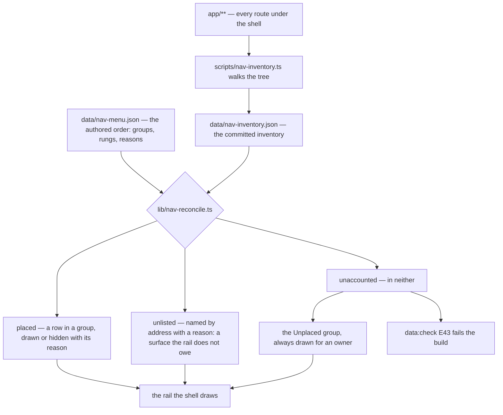

# v2.0.0-rc2 — the rail reconciles, and the demo lane refuses

<!-- docs-nav:begin -->

[Docs hub](../README.md) › **Release notes** › v2.0.0-rc2 · prev [v2.0.0-rc1.4](v2-0-0-rc1-4.md) · next [v2.1.0](v2-1-0.md)

<!-- docs-nav:end -->

Four commits, and the window is a housekeeping cut with two real claims in it: **a destination can
no longer exist in the tree and in nobody's rail** (#1334), and **a demo writer can no longer reach
production without being stopped** (#1337). The other two keep the record honest — the nightly demo
reset and the env spec now name the project the database actually lives in (#1335), and platform
health was re-recorded against the cut before this one (#1330).

Neither claim is a surface. There is no new screen in this window and no screen was redrawn: what
moved is the mechanism that decides what the rail draws, and the mechanism that decides which
database a write may open. That is the honest shape of a candidate-line pool cut between two
product cuts, and it is why the Known limits block below spends its first bullet on the number
rather than on a feature.

## The rail: a derived inventory, and an authored order beside it

The rail used to be a component with a list in it. A list in a component can be **short** — and
nothing failed when it was. `#542` phase 2 found `/admin/console` in exactly that state: a route
serving requests, owned by nobody's menu, invisible to every check the gate ran.

`#1334` splits the question in two and reconciles the halves:

The model is subtraction, and the direction matters. The document may **order**, **group**,
**role-gate** and **hide** a surface; it may never **lose** one. A third state — `unaccounted`, in
neither the document nor the `unlisted` list — is not a default, it is a finding, and it is drawn in
a visible `Unplaced` group _and_ fails `pnpm data:check` under a rule code of its own. A dead end is
then impossible by construction rather than by review, which is the only version of this rule that
survives a busy week.

The two ways of saying "not drawn" are deliberately different things. `hidden` is a _rail row_ that
kept its word, its glyph and its place — `/admin/growth` is off the rail on the owner's ruling
(#1095) and comes back by deleting one key. `unlisted` is a _surface the rail does not owe_: the
console's three detail lists, `/settings`, a failed-create page. It carries no glyph and no fixture
copy, because inventing a word for a door nobody draws is how a menu fills with rows that read as
destinations. Both carry a reason, and both are checked.

## The demo lane: one endpoint table, and every refusal reads it

The defect was two tables that disagreed. `PRODUCTION_HOST_MARKER` named the **retired** project's
endpoint — so when the project moved, every demo writer kept refusing the old host and silently
accepted the new production one. `pnpm demo:verify` on a checkout whose `.env.local` still said
`NEON_BRANCH=demo` opened the live branch and passed. `pnpm db:seed` had no refusal at all.

`#1337` replaces both with `scripts/neon-endpoints.mjs`: one table of endpoint ids, project names and
the role each plays, committed because it holds no credential and no host suffix. Every refusal in
`scripts/` derives its marker from it, so a project move is one edit and the guard follows instead of
drifting. It is a **denylist, never an allowlist** — a scratch branch cut from `demo` stays seedable
without a second table to maintain — and `pnpm demo:env` exits 1 on exactly the combination that used
to slip through: a shell labelled `demo` sitting over production's endpoint.

The refusal is the feature, and it has a cost that belongs in the release notes rather than in a
postmortem: a demo write now needs the demo branch's own values, and a green `pnpm demo:verify`
proves the seed, never the label the shell carried.

## The record, on the page that renders it

The still is this worktree's dev server, `/admin/docs/releases`, 1440 CSS px, the AlignSynch brand,
signed in as `admin@demo.alignsynch.test` — the seat the route is gated for.
`docs/qa/release-2.0.0-rc2/capture-admin-releases.mjs` is the capture and it is re-runnable: before
the shutter it asserts that `/api/version` names this tree, that the frame is 1440 with a stylesheet
that loaded, that the record's newest row is `2.0.0-rc2` with this entry's own date, and that the
brand is not QuizHub — the template build renders the same tree, so a still of it would pass three of
those four checks and show the wrong product.

That page is the right illustration for this particular cut, because it is the only screen whose
content is the release itself: it reads `CHANGELOG.md` and `docs/changelog/releases.json` on every
request, so the row it shows is the row this PR adds.

## What else moved

- `#1335` — the nightly demo reset and `docs/reference/env-spec.md` both still named the paused Neon
  project, so the reset workflow would have targeted a database nobody serves.
- `#1330` — platform health re-recorded at `v2.0.0-rc1.4`, which is the record this cut's own
  `--check` reads as "production serving the base".
- `#1336` — the issue behind the endpoint table; `#1337` is the commit that lands it.

## The entry

<!-- changelog-view:begin entry -->
<!-- generated from CHANGELOG.md by scripts/changelog-view.mjs — edit the entry, not this block -->

- **Released** 2026-11-21
- **Tag** [`v2.0.0-rc2`](https://github.com/riolabs-ai/alignsynch/releases/tag/v2.0.0-rc2)
- **Pull requests named** 4
- **The entry** [`CHANGELOG.md`](../../CHANGELOG.md)

> **Declared override.** The commit census computes 2.1.0 (minor, 4 commit(s) since v2.0.0-rc1.4); this release is cut as 2.0.0-rc2 by decision: the 2.0.0-rc candidate line continues: 2.0.0 final has never been released and milestone #28 still holds 28 open spec issues (#1294 is the platform-acceptance criterion), so the census minor bump would claim a public line that does not exist; milestone #26 names this candidate; owner decision 2026-11-21 (option B) cuts rc2 now and holds the official number
>
> `pnpm release:cut` printed this banner and wrote it here so the number is a declared artefact in a published document, never a silent one.

### Added

- `feat(nav)` — the reconciler: a derived inventory plus the authored order, with a visible Unplaced group (#862) ([#1334](https://github.com/riolabs-ai/alignsynch/pull/1334))

### Fixed

- `fix(ci,docs)` — point the demo reset and the env spec at the live Neon project ([#1335](https://github.com/riolabs-ai/alignsynch/pull/1335))

### Maintenance

- `db(guard)` — one endpoint table, and every demo writer refuses production on it (#1336) ([#1337](https://github.com/riolabs-ai/alignsynch/pull/1337))
- `chore(health)` — re-record v2.0.0-rc1.4 at 834e99dda ([#1330](https://github.com/riolabs-ai/alignsynch/pull/1330))
<!-- changelog-view:end -->

<!-- changelog-view:begin limits -->
<!-- generated from CHANGELOG.md by scripts/changelog-view.mjs — edit the entry, not this block -->

- **The number is declared, and the census disagrees with it.** `v2.0.0-rc1.4..HEAD` is 4 commits — one `feat:` and three other — so `pnpm release:cut --check` computes `2.1.0` (minor) and `~/.hermes/bin/release_boundary.py` agrees with it. This tree is cut as `2.0.0-rc2` by decision, and the decision is a fact about the 2.0.0 line, not about this window: **`2.0.0` has never been released**, milestone #28 "v2.0.0 — the official release" still holds **28 open** spec issues, and **`#1294` — "the 2.0 platform (website, user app, admin) is deployed and accepted" — is the criterion that number waits on**. So `2.1.0` would claim a public line that does not exist and `2.0.0` would claim an acceptance that has not happened; `v2.0.0-rc2` is a candidate _of_ the 2.0.0 line, not the line, and `v1.22.0` remains the newest stable release. Milestone #26 "v2.0.0-rc2 — the pool" names this candidate. The banner at the top of this entry is `pnpm release:cut`'s own record of the override, not a note added afterwards.

- **This window carries no schema change, and the demo writers now refuse the wrong database by construction.** `v2.0.0-rc1.4..HEAD` touches zero files under `db/migrations/`, so nothing new has to be applied before this build serves. What the window does change is who may write: `scripts/neon-endpoints.mjs` holds one endpoint table, and every demo writer refuses production on it — a shell whose `NEON_BRANCH=demo` sits over production's endpoint is stopped before a client is opened, and `pnpm demo:env` exits 1 on exactly that combination. The refusal is the feature. Its consequence is a limit: a demo write now needs the demo branch's own values (`neon env pull` for that branch), and a green `pnpm demo:verify` proves the seed, never the label the shell carried.

- **No browser walk of the changed screens on a live deployment.** Every change in this window is a script, a guard, a nav derivation, a test fixture or a document; none of it re-walks a screen over HTTP against production. The evidence is `bash scripts/verify.sh` green on this tree, the cases the pull requests added (`tests/nav-reconciler.test.ts`, `tests/neon-endpoints.test.ts`, `tests/db-seed-guard.test.ts`), and the guard's refusal proven read-only on this machine rather than on a deployed host.

- **The atlas sweep for this version is deferred, and the deferral is on file.** `docs/qa-atlas/DEFERRED.md` carries the row for `v2.0.0-rc2` — the version, the date, the commit the release is cut from, and the reason — rather than a capture, because atlas generation is stopped by the owner's decision (#1094) and the subjects this window changed (the nav derivation's Unplaced group, the demo lane's seed path, a guard that refuses before connecting) are states the atlas cannot reach.

- **The rectification register still describes work this cut does not do.** `docs/specs/v2-rectification.md` reads 51 rows as **25 `deltas`**, **13 `unverifiable`**, **3 `not-built`** and **10 `matches`**. The 25 deltas and the 13 rows the instrument could not reach are real, user-visible work that stays open; nothing in this cut says the rectification is complete, and clearing a row is a docs-intake act on that doc's own frontmatter, not a decision this cut can take.
<!-- changelog-view:end -->

<!-- docs-nav:begin -->

[Docs hub](../README.md) › **Release notes** › v2.0.0-rc2 · prev [v2.0.0-rc1.4](v2-0-0-rc1-4.md) · next [v2.1.0](v2-1-0.md)

<!-- docs-nav:end -->
