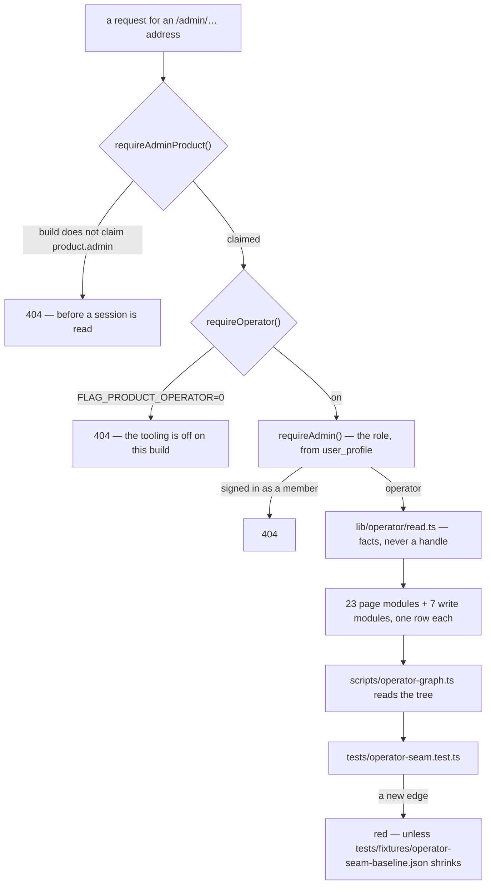

# v2.1.0 — the operator surface

<!-- docs-nav:begin -->

[Docs hub](../README.md) › **Release notes** › v2.1.0 · prev [v2.0.0-rc2](v2-0-0-rc2.md)

<!-- docs-nav:end -->

Thirty-two commits since `v2.0.0-rc2`, and the window makes one argument: **the operator's tooling
is a surface with a boundary, not a shelf of admin pages that happened to exist**. Five commits carry
that claim — a build capability that can answer 404 for the whole back office (#1394), the write path
that the page gate did not close until #1396, the enumeration that makes "which files are the
operator's" a fact instead of a convention (#1395), the read contract those files go through, and the
one-way arrow a test now enforces between the operator surface and the product.

The rest of the window is what an operator sees when they arrive. `/admin` itself still answers 404 —
the landing is `/admin/dashboard` and is called Dashboard (#1382), it opens on a read-only start page
(#1376), the rail above it groups the six surfaces an operator uses into five sections (#1380), and
a pill row moves between the landing and the console without the header menu (#1378). A release note
that listed those five screens and stopped would be describing the furniture; the mechanism below is
what makes the furniture movable.

## A capability, and the action behind the page

`product.operator` is the back office's own switch, declared beside `product.admin` in `data/flags.ts`
and read through `OPERATOR_FLAG` in `lib/brand-boundary.ts`. It answers one question — _does this build
ship the operator's tooling at all_ — and it answers it the way an unclaimed address is answered:
`requireOperator()` calls `notFound()`, so a template that never named itself gets the same 404 an
unknown URL gets, before a session is read. `FLAG_PRODUCT_OPERATOR=0` closes the twenty-three routes
on a build that does ship them, and reopens them by deleting one call. Nothing was moved, renamed or
deleted to achieve that, which is the review path this release is buying.

The order is part of the contract: `requireAdminProduct()`, then `requireOperator()`, then
`requireAdmin()`. The first two are facts about the build; the third is the role, read from
`user_profile` for that request. **The capability is not a permission**, and the released code says
so in the module that defines it — an operator surface is not a role, and a role is still the only
thing that decides who may act.

The gate shipped in two halves, and the second half is a fix rather than a feature. #1394 closed the
pages; #1396 found that a page gate closes an address, not an action — a POST to a server action
never renders the guarded page module, so an action id scraped from an older build still wrote.
`OPERATOR_ACTION_FILES` in `lib/operator/routes.ts` now names the seven write modules beside the
twenty-three page modules, and the gate is applied to both.

## The surface is enumerated once

`lib/operator/routes.ts` holds three constants and nothing else: `OPERATOR_ROUTES` (23 rows, address
and page module in one row — two parallel lists drift, a row cannot), `OPERATOR_ACTION_FILES` (the
seven write modules), and `OPERATOR_EXCLUDED_PATTERNS` (the three surfaces a reader would expect in
the list and must not find there: `/admin/docs/[...slug]`, `/admin/templates*` and `/admin/console*`).
`tests/operator-seam.test.ts` asserts the bijection against the tree: a new admin page is either named
in the surface or named in an exclusion, never silently ungated. Widening the set by judgement is a
red test instead of a quiet decision.

## The contract: facts, never a handle

`lib/operator/read.ts` is the one module the surface reads through. It exposes route inventory, audit
rows, the spec register, template versions, the review shelf, the permissions matrix and the mail
register — as plain readonly records and `z.infer` types, with no component, no `ReactNode`, no pool
and no query builder. A read that cannot answer is a **value**, `{ ok: true, rows } | { ok: false,
reason }`, so a database that is down draws one panel with its own sentence instead of a 500; anything
that is not that error is rethrown, because a bug must not be reported as an outage. Reading a new kind
of fact means adding one named read here, not importing `lib/db/**` into a page.

## The arrow, and a baseline that may only shrink

`scripts/operator-graph.ts` is pure — `{ file → source }` in, edges and findings out — and reuses
`scripts/client-graph.ts` so the parser has one home. Three rules: the operator surface may not import
a product page or a product component; operator-owned modules may not reach an internal layer or `pg`
except through the contract; and product code may not import `lib/operator/**` or
`components/operator/**` at all, value **or** type — a page shaped by the tooling is already the
coupling the rule exists to catch.

The baseline is the honest half of that: `tests/fixtures/operator-seam-baseline.json` names the
violations the seam did not fix, and it may only shrink. It reads **23 operator page files** at the
start of this window and **2** now; the eight component files the surface also carries are unchanged,
so the remaining work is legible instead of averaged away. A row that stops being a violation fails
the test, which is what makes it a baseline rather than an allowlist.

One component came out of the seam: `components/operator/frame.tsx`, the page column.
`tests/admin-column.test.tsx` renders it beside the product's `StageColumn` with the same child and
asserts **identical markup**, so a width change on one side fails a test instead of becoming a second
left edge.

## What an operator sees first

`app/(mainlayout)/admin/dashboard/page.tsx` is the landing, and it is deliberately small: four reads
that other screens already make — the inbox, the review shelf, the session registry and the audit log —
folded through `startFigures()` and printed as a read-only start page. Nothing on it writes: no form,
no server action, no mutation. Each of the four is caught separately, so one unreadable fact becomes
one panel that carries the database's own reason while the directory below it still renders, because
that directory is a route list and not a query.

Above it, the rail now reads five sections — Start, Operations, Content, Specs and Member — instead of
the two interleaved groups a member saw before (#1380), and the landing and the console share one pill
row (#1378) whose items are data: `data/admin/submenu.ts` names every address and every word, and
`aria-current` is derived from the path the page passes in, so the row adds no JavaScript.

The window also gives the release note itself a mechanism: `docs/changelog/updates/<pr>.json` is one
validated entry per pull request (#1346) — the change, its `reader_impact` and the `specs[]` the rule
now lives in — and the entry below is assembled from those rows (#1352) rather than retyped from commit
subjects. Where the ledger has no row, the bullet says so: three `feat`/`fix` commits in this range are
named in the entry's ledger-coverage banner instead of being silently smoothed over.

## The stills

The first still is this tree: a dev server started from the release branch, `/glossary`, 1440 CSS px,
the AlignSynch brand, signed out — the capture asserts the viewport, that a stylesheet actually
painted the frame, that the page carries the glossary's own terms, and that it is not the QuizHub
build before it writes a file.

The second is **not** this tree, and the difference is the release's own Known limits: the capture rig
signs in against the demo branch, and that branch was archived in Neon on 2026-11-22, so there is no
signed-in frame of `/admin/dashboard` this release can honestly show. The audit log is the closest
surface that is genuinely the operator's, and it is captioned with the version that produced it rather
than presented as this one.

## What else moved

- `#1393` — the public glossary, rendered from `docs/glossary.md`; Reviews stays unpublished because no
  real reviews exist yet.
- `#1392` — a sitemap, and `robots` naming the three private surfaces.
- `#1397` — the Payment tab opens the customer's own invoices and receipts.
- `#1398` — `docs/` is a deterministic versioned bundle: `DOCS_SOURCE` unset reads the checkout exactly
  as before, so no screen changes until a deployment opts in.
- `#1371`, `#1375`, `#1372` — founder issue intake, a mention labeller that fires without the laptop
  polling, and a watch that reaches the lead with the steer attached.
- `#1408`, `#1403`, `#1402` — the weekly offboarding script, the unlinked-branch triage, and the two
  artefacts the 271-branch audit recovered.

## The entry

<!-- changelog-view:begin entry -->
<!-- generated from CHANGELOG.md by scripts/changelog-view.mjs — edit the entry, not this block -->

- **Released** 2026-11-26
- **Tag** [`v2.1.0`](https://github.com/riolabs-ai/alignsynch/releases/tag/v2.1.0)
- **Pull requests named** 40
- **The entry** [`CHANGELOG.md`](../../CHANGELOG.md)

> **Ledger coverage — 3 `feat`/`fix` commit(s) in this range carry no `docs/changelog/updates/<pr>.json` entry:** #1392, #1387, #1376. Their bullets read as the commit subject alone. The ledger entry — its `reader_impact` and the `specs[]` the rule now lives in — is written in the pull request that makes the change, so this is a finding about the range, never a refusal of the cut.

### Added

- `feat(docs)` — the publish boundary — docs/ is a deterministic versioned bundle (#1398) ([#1407](https://github.com/riolabs-ai/alignsynch/pull/1407)) · Who notices: Nobody sees a different screen yet: `DOCS_SOURCE` unset reads `docs/` from the checkout exactly as before, so `/admin/docs*` and every docs-backed page render unchanged; the archive and its CI artifact are what a deployment opts into. · Rule: [docs/reference/env-spec.md](https://github.com/riolabs-ai/alignsynch/blob/v2.1.0/docs/reference/env-spec.md)
- `feat(billing)` — the Payment tab opens the customer's own invoices and receipts (#1282) ([#1397](https://github.com/riolabs-ai/alignsynch/pull/1397)) · Who notices: A member with a provider subscription can reach their invoices and receipts from `/dashboard/payment`; a card-free trial and the offline adapter's rows still read "No charges yet." and draw no control. · Rule: [docs/reference/billing.md](https://github.com/riolabs-ai/alignsynch/blob/v2.1.0/docs/reference/billing.md)
- `feat(operator)` — the operator seam — one read contract, one arrow, a baseline that only shrinks (#1391) ([#1395](https://github.com/riolabs-ai/alignsynch/pull/1395)) · Who notices: No screen changes — the same screens with the same geometry; what moves is that operator tooling can now change without editing the user platform, and a new coupling fails a test. · Rule: [docs/specs/operator-seam.md](https://github.com/riolabs-ai/alignsynch/blob/v2.1.0/docs/specs/operator-seam.md)
- `feat(admin)` — the operator back office is a capability of its own — `product.operator`, 404 for a build that does not claim it (#1391) ([#1394](https://github.com/riolabs-ai/alignsynch/pull/1394)) · Who notices: Nothing changes on either template this tree ships, and `FLAG_PRODUCT_OPERATOR=0` closes the twenty-three routes on a build that has them — gated, never moved. · Rule: [docs/diagrams/brand-boundary.md](https://github.com/riolabs-ai/alignsynch/blob/v2.1.0/docs/diagrams/brand-boundary.md)
- `feat(web)` — /glossary publishes docs/glossary.md; reviews stay deferred (#1289) ([#1393](https://github.com/riolabs-ai/alignsynch/pull/1393)) · Who notices: A visitor can look up what an Aspect, a Gap or a Template is without an account, and the words are the schema comments the product is built from; Reviews is deliberately not published because no real reviews exist yet. · Rule: [docs/diagrams/gate.md](https://github.com/riolabs-ai/alignsynch/blob/v2.1.0/docs/diagrams/gate.md), [docs/ui-registry.md](https://github.com/riolabs-ai/alignsynch/blob/v2.1.0/docs/ui-registry.md)
- `feat(seo)` — the public site publishes a sitemap, and robots names the three private surfaces (#1290) ([#1392](https://github.com/riolabs-ai/alignsynch/pull/1392))
- `feat(admin)` — the landing is /admin/dashboard and is called Dashboard (#1382) ([#1387](https://github.com/riolabs-ai/alignsynch/pull/1387))
- `feat(triage)` — deterministic founder-issue classifier: enrich, re-title, label, milestone and ledger — append-only ([#1371](https://github.com/riolabs-ai/alignsynch/pull/1371)) · Who notices: The founder's twelve freeform issues stop being untitled, unlabelled duplicates: each carries an area, a class and a milestone, the original title is kept verbatim, and a standing ledger lists them. · Rule: [docs/operations/issue-intake.md](https://github.com/riolabs-ai/alignsynch/blob/v2.1.0/docs/operations/issue-intake.md)
- `feat(admin)` — the Delivery history exhibit is a review artifact — one row, one file, no new surface ([#1379](https://github.com/riolabs-ai/alignsynch/pull/1379)) · Who notices: A signed-in reviewer opens `/admin/review?artifact=delivery-history-v1` and reads the Oct 28 → Nov 23 window in the shell, with its release grouping and the rest of the shelf, instead of asking the owner for a file. · Rule: [docs/review/artifacts.json](https://github.com/riolabs-ai/alignsynch/blob/v2.1.0/docs/review/artifacts.json)
- `feat(nav)` — five-section rail — Start surfaced, operations and settings untangled ([#1380](https://github.com/riolabs-ai/alignsynch/pull/1380)) · Who notices: An administrator's rail now opens on the admin landing and groups the six surfaces one operator uses together, while a member still sees the same six `/dashboard/*` rows under one section instead of two. · Rule: [docs/reference/env-spec.md](https://github.com/riolabs-ai/alignsynch/blob/v2.1.0/docs/reference/env-spec.md)
- `feat(admin)` — a shared submenu over the admin's sibling routes ([#1378](https://github.com/riolabs-ai/alignsynch/pull/1378)) · Who notices: An operator can now move between the admin landing and the console it points at without the header menu; both screens keep their gates, no page changed, and `/admin` still answers 404. · Rule: [docs/specs/ux-reference-patterns.md](https://github.com/riolabs-ai/alignsynch/blob/v2.1.0/docs/specs/ux-reference-patterns.md)
- `feat(gh)` — watch-mentions — an @alignsynch mention reaches the lead with the steer attached ([#1372](https://github.com/riolabs-ai/alignsynch/pull/1372)) · Who notices: The lead learns of an owner mention on its own, with the steer attached, instead of finding it only when someone pastes the link. · Rule: [docs/operations/mentions.md](https://github.com/riolabs-ai/alignsynch/blob/v2.1.0/docs/operations/mentions.md)
- `feat(ci)` — mention queue — label a thread the moment `@alignsynch` appears (#1373) ([#1375](https://github.com/riolabs-ai/alignsynch/pull/1375)) · Who notices: Someone who addresses `@alignsynch` sees the thread marked within seconds even when the laptop that polls mentions is off, instead of the question sitting unanswered until they paste the link. · Rule: [docs/operations/issue-intake.md](https://github.com/riolabs-ai/alignsynch/blob/v2.1.0/docs/operations/issue-intake.md)
- `feat(admin)` — a read-only start page as the admin landing (#1374) ([#1376](https://github.com/riolabs-ai/alignsynch/pull/1376))
- `feat(ci)` — founder issue intake ([#1367](https://github.com/riolabs-ai/alignsynch/pull/1367)) · Who notices: Someone filing founder feedback gets a classified issue and a reply naming the form, instead of an unlabelled issue that triage must repair before it can be carded. · Rule: [docs/operations/issue-intake.md](https://github.com/riolabs-ai/alignsynch/blob/v2.1.0/docs/operations/issue-intake.md)
- `feat(release)` — the changelog entry is assembled from the update ledger ([#1352](https://github.com/riolabs-ai/alignsynch/pull/1352)) · Who notices: Whoever reads the next release note gets each change's who-notices clause and the document its rule now lives in, instead of a census of commit subjects. · Rule: [docs/operations/releasing.md](https://github.com/riolabs-ai/alignsynch/blob/v2.1.0/docs/operations/releasing.md)
- `feat(admin)` — the update ledger — one validated entry per PR, linked into the Admin Specs (#1345) ([#1346](https://github.com/riolabs-ai/alignsynch/pull/1346)) · Who notices: An admin or a stakeholder can see what one merge changed and which document the rule now lives in — from /admin/docs/updates and from each release's own commit rows. · Rule: [docs/specs/admin-updates.md](https://github.com/riolabs-ai/alignsynch/blob/v2.1.0/docs/specs/admin-updates.md)
- `feat(ops)` — commit the 170 prototypes and rebuild the catalogue from them (#1405) (#1420) ([#1420](https://github.com/riolabs-ai/alignsynch-web/pull/1420))
- `feat(ops)` — the prototype catalog rebuilds on merge, dates from git, versions from tags (#1405) (#1409) · Who notices: All 225 rows carry a git date and a tag-derived version — no mtime guesses, no path-inferred versions — and the deep link at `/p/project-spec/spec-design-page-relationship-detail/alignsynch-ui-specs.html` still resolves. · Rule: [docs/operations/prototype-catalog.md](https://github.com/riolabs-ai/alignsynch-web/blob/v2.1.0/docs/operations/prototype-catalog.md) ([#1409](https://github.com/riolabs-ai/alignsynch-web/pull/1409))
- `feat(admin)` — the update ledger moves to data/ — 24 rows, 12 readers, E44 unchanged (#1413) (#1414) · Who notices: An admin reading `/admin/docs/updates` sees the same rows, order and links; the published docs bundle no longer carries the app's ledger, and a bundle gate checks `specs[]` against the tree it serves. · Rule: [docs/specs/admin-updates.md](https://github.com/riolabs-ai/alignsynch-web/blob/v2.1.0/docs/specs/admin-updates.md), [docs/operations/releasing.md](https://github.com/riolabs-ai/alignsynch-web/blob/v2.1.0/docs/operations/releasing.md) ([#1414](https://github.com/riolabs-ai/alignsynch-web/pull/1414))
- `feat(docs)` — the app consumes the bundle — two lanes, two sources (#1399) (#1411) · Who notices: Nobody sees a different screen: both lanes draw `/admin/docs*`, `/glossary` and the spec register identically, and the run prints `docs source: local|bundle` beside its lane. · Rule: [docs/reference/env-spec.md](https://github.com/riolabs-ai/alignsynch-web/blob/v2.1.0/docs/reference/env-spec.md) ([#1411](https://github.com/riolabs-ai/alignsynch-web/pull/1411))
- `feat(dev)` — pnpm dev:ready answers seed-or-start without the seed lock (#1401) (#1406) · Who notices: A developer who opens `/demo` on a branch whose accounts are gone gets them back with one command, a branch with no database prints one line and starts, and `pnpm dev` still starts in under a second. · Rule: [docs/getting-started/demo.md](https://github.com/riolabs-ai/alignsynch-web/blob/v2.1.0/docs/getting-started/demo.md) ([#1406](https://github.com/riolabs-ai/alignsynch-web/pull/1406))

### Fixed

- `fix(admin)` — the operator gate closes the page but not the action (#1391) ([#1396](https://github.com/riolabs-ai/alignsynch/pull/1396)) · Who notices: Nothing changes on either template this tree ships; `FLAG_PRODUCT_OPERATOR=0` now closes the write path as well as the twenty-three pages, so an action id scraped from an older build cannot be POSTed. · Rule: [docs/diagrams/brand-boundary.md](https://github.com/riolabs-ai/alignsynch/blob/v2.1.0/docs/diagrams/brand-boundary.md)
- `fix(docs)` — md-normalised must not treat an inline backtick-less < as the start of an HTML tag (#1388) ([#1389](https://github.com/riolabs-ai/alignsynch/pull/1389)) · Who notices: Six pages that `md:normalised:check` could not see are covered again: `docs/operations/mentions.md` alone recovers 434 words, including `labeller`, `queue` and `founder`. · Rule: [docs/operations/repo-layers.md](https://github.com/riolabs-ai/alignsynch/blob/v2.1.0/docs/operations/repo-layers.md)
- `fix(ci)` — the mention labeller ignores the answer, so answering drains the queue ([#1383](https://github.com/riolabs-ai/alignsynch/pull/1383)) · Who notices: A founder's question stays labelled until it is answered and the label is cleared, instead of the label returning six seconds after the reply. · Rule: [docs/operations/mentions.md](https://github.com/riolabs-ai/alignsynch/blob/v2.1.0/docs/operations/mentions.md)
- `fix(env)` — env:sync --prune --write is a retire verb — it skips the value pass (#1349) ([#1350](https://github.com/riolabs-ai/alignsynch/pull/1350)) · Who notices: An operator running a prune sees one DELETE and a `prune mode — N declared row(s) not written` line instead of five new rows on the demo scope. · Rule: [docs/operations/resend-inbound.md](https://github.com/riolabs-ai/alignsynch/blob/v2.1.0/docs/operations/resend-inbound.md), [docs/reference/env-spec.md](https://github.com/riolabs-ai/alignsynch/blob/v2.1.0/docs/reference/env-spec.md)
- `fix(ci)` — the prototype catalog tells "no input" from "broken input" — a notice when prototypes/ is absent, a named failure when the root is configured (#1419) (#1421) · Who notices: Operators reading the Actions tab: `main` stops being red for a tree that has not been committed yet, and a wrong PROTOTYPE_ROOT still fails by name instead of skipping the deploy. · Rule: [docs/operations/prototype-catalog.md](https://github.com/riolabs-ai/alignsynch-web/blob/v2.1.0/docs/operations/prototype-catalog.md) ([#1421](https://github.com/riolabs-ai/alignsynch-web/pull/1421))
- `fix(ci)` — the icon-fill case stops being a "flake" — one decode per raster, and a suite timeout that is not a correctness threshold (#1417) (#1418) · Who notices: Nobody sees a different screen: the ink floors and every measured fraction are unchanged, and a swapped raster still reddens the case. Release cuts stop refusing a sha over a CPU-bound measurement on a loaded box. · Rule: [docs/operations/gate.md](https://github.com/riolabs-ai/alignsynch-web/blob/v2.1.0/docs/operations/gate.md) ([#1418](https://github.com/riolabs-ai/alignsynch-web/pull/1418))
- `fix(ops)` — the Node guard runs before the entry point's `.ts` import is resolved — dynamic import plus a pre-hook (#1410) (#1416) · Who notices: Nobody outside the repository — operator scripts; on a host below the declared engine the people who run them get one sentence naming both versions, from `pnpm` through the pre-hook and from a bare `node` through the entry point. · Rule: [docs/operations/branch-triage.md](https://github.com/riolabs-ai/alignsynch-web/blob/v2.1.0/docs/operations/branch-triage.md) ([#1416](https://github.com/riolabs-ai/alignsynch-web/pull/1416))
- `fix(ops)` — pnpm hygiene names the runtime it needs instead of dying in Node's loader (#1412) · Who notices: Nobody outside the repository — it is an operator script; for the people who run it, a host on the wrong runtime gets one sentence naming both versions rather than `ERR_UNKNOWN_FILE_EXTENSION` pointing at a file that was never wrong. · Rule: [docs/operations/branch-triage.md](https://github.com/riolabs-ai/alignsynch-web/blob/v2.1.0/docs/operations/branch-triage.md) ([#1412](https://github.com/riolabs-ai/alignsynch-web/pull/1412))

### Maintenance

- `chore(ops)` — repo-hygiene — the weekly offboarding run, with a df delta and an idempotence proof (#1404) ([#1408](https://github.com/riolabs-ai/alignsynch/pull/1408))
- `docs(ops)` — the unlinked-branch triage — 55 clean branches classified, 1 wanted ([#1403](https://github.com/riolabs-ai/alignsynch/pull/1403))
- `docs(review)` — land the two artefacts the 271-branch audit recovered — comments mockup v2 + APP-13 (#1400) ([#1402](https://github.com/riolabs-ai/alignsynch/pull/1402))
- `chore(health)` — re-record the platform record — the 72 h freshness window had expired ([#1386](https://github.com/riolabs-ai/alignsynch/pull/1386))
- `ops(env)` — refresh the store census after the render (#1338, #1339) ([#1348](https://github.com/riolabs-ai/alignsynch/pull/1348))
- `ops(env)` — env:sync --prune retires a forbidden row (#1343) ([#1347](https://github.com/riolabs-ai/alignsynch/pull/1347))
- `chore(health)` — re-record after v2.0.0-rc2 ([#1344](https://github.com/riolabs-ai/alignsynch/pull/1344))
- `ops(env)` — the declared vault rows name the live project, and env:render refuses a retired endpoint (#1339) ([#1341](https://github.com/riolabs-ai/alignsynch/pull/1341))
- `ops(mail)` — the demo deployment refuses the Resend account webhook — 410 by deployment identity (#1338) ([#1342](https://github.com/riolabs-ai/alignsynch/pull/1342))
- `chore(release): 2.1.0 — the operator surface (#1415)` — ([#1415](https://github.com/riolabs-ai/alignsynch-web/pull/1415))
<!-- changelog-view:end -->

<!-- changelog-view:begin limits -->
<!-- generated from CHANGELOG.md by scripts/changelog-view.mjs — edit the entry, not this block -->

- **The scripts need Node 24.** `engines.node: 24.x` is not advisory. The script entry points import
  TypeScript source through `scripts/ts-modules.mjs`, which relies on Node's type stripping; on Node 18
  `pnpm hygiene` and `pnpm release:check` die with `ERR_UNKNOWN_FILE_EXTENSION` or
  `bad option: --disable-warning`. The failure names a file, not the engine, so it reads as a code bug.
- **The operator surfaces are a build capability, not a permission.** `product.operator` returns 404 for
  a build that does not claim it; it does not grant a role, and it is not an authorization check. The
  role gates in front of `/admin/**` are unchanged and still the thing that decides who may act.
- **One home for operator tooling is still undecided.** The seam exists (one read contract, one arrow, a
  shrink-only baseline); whether the operator back office becomes a package, its own deployment or its
  own repo is deliberately deferred. Nothing here makes that cheaper than it was, and nothing here makes
  it harder.
- **The prototype catalog is public and unlisted.** 252 HTML prototypes behind `noindex` on
  `alignsynch-mockups.vercel.app`, rebuilt by hand in this release. No access control; anything shared
  from it is readable by anyone with the link.
- **The demo environment reseeds on a schedule driven by one credential.** The reset workflow needs a
  Neon key scoped to `alignsynch-neon`; when the key's scope drifted, the workflow answered
  `404 project not found` and the demo went stale for four days before anyone noticed. There is no
  alarm on that path, only the next scheduled run.
- **Branch and worktree hygiene is now a script, not a habit.** The repo reached 20 GB and 1,138 local
  branches because nothing offboarded on merge. `repo-hygiene` prunes and reports, but nothing schedules
  it yet, so the reclaim is still manual.
- **32 branches remain held by worktrees** and are deliberately not deleted while those worktrees exist;
  only the recovered-work bundle (`alignsynch-org/alignsynch-branch-archive`, release `v2026-11-25`) is
  provably off-machine, and only for the branches deleted on 2026-11-26.
<!-- changelog-view:end -->

<!-- docs-nav:begin -->

[Docs hub](../README.md) › **Release notes** › v2.1.0 · prev [v2.0.0-rc2](v2-0-0-rc2.md)

<!-- docs-nav:end -->
